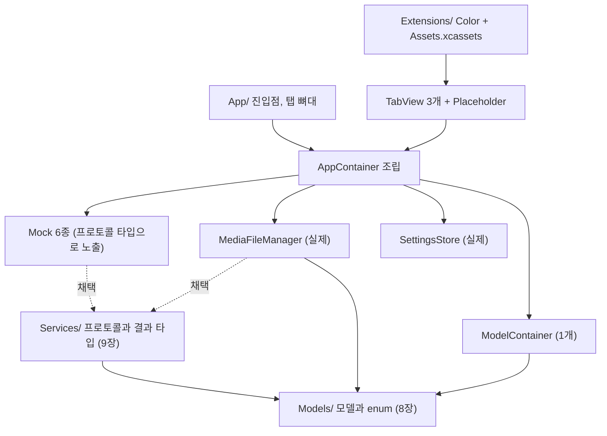
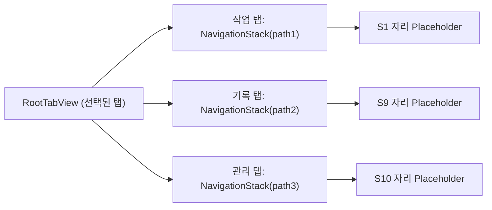
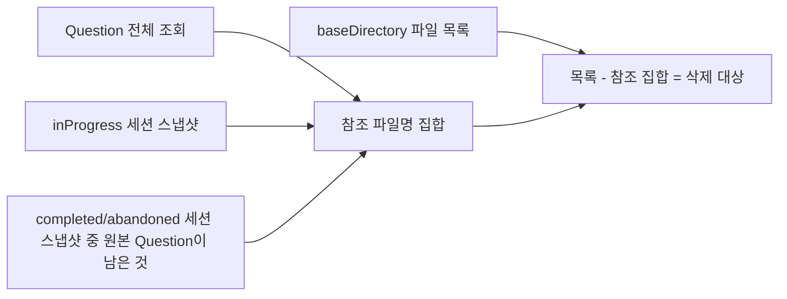
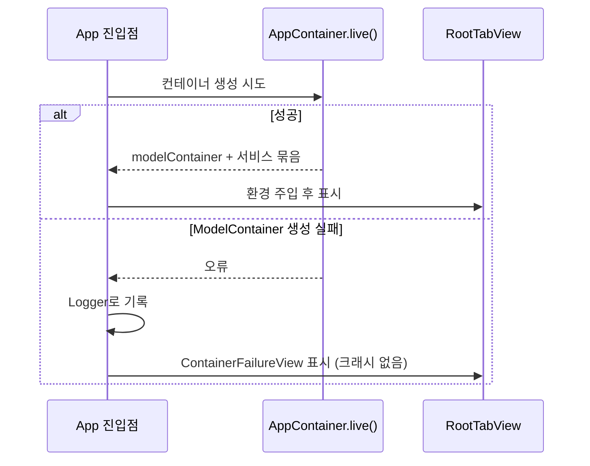

# 설계 문서: app-foundation

## Overview

`app-foundation`은 다른 모든 Spec이 의존하는 앱 기반을 만듭니다. 이 Spec이 제공하는 것은 **계약(모델, 프로토콜, 결과 타입), mock, 조립(wiring), 두 개의 실제 구현(`MediaFileManager`, `SettingsStore`), 탭 뼈대, 색상 Asset 틀, 테스트 타깃**입니다. 세션 로직, 화면 S1~S12, 시드 로더, 애니메이션 장면은 범위 밖입니다(요구사항 12.7).

설계 원칙은 다음과 같습니다.

- **계약은 steering이 기준입니다.** 모델과 프로토콜의 이름, 필드, 시그니처는 `project-spec.md` 8장과 9장을 따르며, 이 문서는 선언을 복사하지 않고 절 번호와 타입 이름으로 참조합니다. 새 모델, 필드, 프로토콜, 화면을 만들지 않습니다(요구사항 3.5, 4.4).
- **구현은 프로토콜 뒤에 둡니다.** `AppContainer`가 서비스를 프로토콜 타입으로 노출해서, 실제 구현으로 바꿀 때 호출하는 쪽 코드를 고치지 않게 합니다(요구사항 7.3).
- **mock과 실제 구현을 구분합니다.** 6개 서비스(`TaskRecommending`, `QuestionSelecting`, `SessionManaging`, `TreeManaging`, `FeedbackPlaying`, `TraceSceneRegistry`)는 mock으로 연결하고, `MediaFileManaging`과 `SettingsStore`는 실제 구현을 연결합니다(요구사항 7.4, 7.5).
- **의존은 주입합니다.** 저장 폴더, `UserDefaults`, `ModelContainer`는 생성자로 받아서 테스트가 임시 폴더, 별도 suite, 메모리 컨테이너를 쓸 수 있게 합니다(요구사항 5.12, 6.3, 7.7, 9.4).

### 검증 범위에 대한 주의

이 문서는 Xcode 빌드 명령(`xcodebuild build`, `xcodebuild test`, `-showBuildSettings`)과 시뮬레이터 동작을 **검증하지 않았습니다.** 아래 명령과 설정 값은 구현 단계에서 foundation 코드를 만든 뒤 실제로 실행해서 확인해야 하는 계획입니다. SwiftData, `Observation`, SwiftUI API 사용 방식도 구현 때 Xcode와 공식 문서로 다시 확인합니다.

### 설계 결정 요약

| # | 결정 | 이유 | 관련 요구사항 |
| --- | --- | --- | --- |
| D1 | 서비스는 프로토콜 타입으로만 `AppContainer`에서 노출 | 구현 교체 시 호출부 수정 0줄 | 7.3 |
| D2 | 미디어 파일명은 `UUID` 기반으로 새로 만든다 | 덮어쓰기 방지, 불변 파일 규칙(8장) | 5.2, 5.3 |
| D3 | 파일 저장은 임시 이름으로 복사한 뒤 이동한다 | 중간 실패 때 일부만 복사된 파일이 남지 않게 함 | 5.5 |
| D4 | 참조 수집은 순수 함수로 분리하고 파일 삭제와 나눈다 | 참조 규칙을 파일 I/O 없이 테스트 | 5.6~5.9 |
| D5 | `SettingsStore`가 키와 기본값 상수를 공개한다 | `@AppStorage`와 같은 키를 문자열 중복 없이 사용 | 6.9 |
| D6 | 탭별 경로 상태를 탭마다 따로 가진다 | 한 탭의 푸시가 다른 탭에 영향 주지 않게 함 | 10.3, 10.6, 10.7 |
| D7 | 테스트 프레임워크, mock 위치, 색상 이름 등은 기본안만 제시하고 확정하지 않는다 | steering에 없는 결정(Q1~Q6) | 열린 질문 |

## Architecture

### 계층과 의존 방향

화면(`App/`, 이후 `Features/`)은 `AppContainer`가 환경으로 주는 프로토콜만 읽습니다. 서비스 구현은 `Models/`를 알지만 화면을 알지 못합니다. `Models/`는 아무것도 의존하지 않습니다.



실제 구현으로 바꾸는 시점(다른 Spec)에는 `AppContainer`의 한 곳에서 mock을 실제 구현으로 교체합니다.

### 탭 구조와 경로 상태

각 탭은 자기 `NavigationStack`과 경로 상태를 가집니다. 탭 선택값은 `TabView`가 가지고, 경로는 탭별 상태로 둬서 탭을 오가도 유지됩니다.



### Xcode 프로젝트 설정 방식 (요구사항 1)

- 프로젝트 파일은 작업 트리 기준 `Santa'sDeliveryCrisis.xcodeproj` 아래의 `project.xcproj`입니다(세션 시작 때의 파일 목록 기준이며, 이름이 일반적인 `project.pbxproj`와 달라서 구현 시 실제 파일을 열어 확인합니다). 소스 폴더 `Santa'sDeliveryCrisis/`는 **폴더 멤버십(파일 시스템 동기화 그룹)**으로 등록된 상태를 유지해서, 폴더에 파일을 추가해도 프로젝트 파일을 고치지 않게 합니다(요구사항 1.7, 2.8).
- 설정 값은 Xcode의 빌드 설정 UI 또는 프로젝트 파일 편집으로 반영하며, 이 문서 단계에서는 바꾸지 않습니다.

| 빌드 설정 | 값 | 적용 대상 | 요구사항 |
| --- | --- | --- | --- |
| `IPHONEOS_DEPLOYMENT_TARGET` | `17.0` | 앱 타깃, 테스트 타깃, Debug와 Release | 1.1 |
| `TARGETED_DEVICE_FAMILY` | `1,2` | 앱 타깃 | 1.2 |
| `INFOPLIST_KEY_UISupportedInterfaceOrientations_iPhone` | `UIInterfaceOrientationPortrait` | 앱 타깃 | 1.3 |
| `INFOPLIST_KEY_UISupportedInterfaceOrientations_iPad` | Portrait, LandscapeLeft, LandscapeRight | 앱 타깃 | 1.4 |
| 패키지 의존성 | 없음 | 프로젝트 | 1.6 |

방향 키 이름은 구현 때 현재 Xcode가 생성하는 `INFOPLIST_KEY_*` 이름으로 확인합니다. 구현 후 `xcodebuild -showBuildSettings`로 앱 타깃과 테스트 타깃의 값을 비교하는 확인 절차(요구사항 1.8)를 스크립트 `Scripts/check-build-settings.sh`로 둘지는 구현 때 정합니다(이 스크립트는 제안이며 필수 산출물은 아닙니다).

## Components and Interfaces

### 폴더 배치 (요구사항 2)

소스 폴더 `Santa'sDeliveryCrisis/` 아래에 steering 10장의 12개 폴더를 만듭니다. 빈 폴더에는 `.gitkeep`을 1개씩 둡니다(요구사항 2.3).

```
Santa'sDeliveryCrisis/
  App/
    Santa'sDeliveryCrisisApp.swift   앱 진입점 (@main), AppContainer 주입      [Q6]
    RootTabView.swift                탭 3개, 탭별 NavigationStack
    PlaceholderScreen.swift          S1/S9/S10 자리 화면
    AppContainer.swift               ModelContainer와 서비스 조립
    ContainerFailureView.swift       ModelContainer 생성 실패 화면
  Models/
    Enums.swift                      QuizCategory, Difficulty, QuestionKind, SessionStatus
    Question.swift
    QuestionSnapshot.swift
    QuizSession.swift
    SessionAnswer.swift
    TreeRecord.swift
  Services/
    Protocols/                       9장 프로토콜 7개 (파일 단위로 분리)
    Results/                         SessionResult, TreeGrantResult, TraceStep, TraceSceneAction
    Media/
      MediaFileManager.swift         MediaFileManaging 실제 구현
      MediaReferenceCollector.swift  참조 파일명 수집 (순수 로직)
    Settings/
      SettingsStore.swift            키와 기본값 상수, 검증
    Mocks/                           Mock 구현 6종                              [Q4]
  Features/
    Task/ Quiz/ Trace/ Records/ Manage/ Settings/   (.gitkeep만)
  Resources/
    Seed/  Sounds/                   (.gitkeep만)
    Assets.xcassets                  색상 세트 (기존 AccentColor는 유지 여부 구현 때 확인)
  Extensions/
    Color+Assets.swift               색상 세트별 정적 프로퍼티
```

- `Assets.xcassets`는 현재 소스 폴더 바로 아래에 있으므로 `Resources/`로 옮깁니다(요구사항 2.2).
- 기존 `MyApp.swift`와 `ContentView.swift`의 이동 또는 교체 범위는 **Q6**으로 남깁니다(기본안은 열린 질문 절 참고).
- 테스트 타깃 폴더는 소스 폴더와 별도로 `Santa'sDeliveryCrisisTests/`로 둡니다(이름은 제안, 구현 때 Xcode가 만드는 이름을 따릅니다).

### 프로토콜 계층과 문서화 주석 (요구사항 4)

`Services/Protocols/`에 9장의 프로토콜 7개를 선언된 이름, 메서드 이름, 매개변수, 반환 타입, `throws` 그대로 둡니다. 9장에 없는 멤버는 넣지 않습니다. `SessionResult`, `TreeGrantResult`, `TraceStep`, `TraceSceneAction`(`.none` 한 개)은 `Services/Results/`에 둡니다.

문서화 주석(`///`)에는 9장에 적힌 동작 계약을 그대로 옮깁니다(요구사항 4.5). 호출하는 쪽이 이 주석만 읽고 계약을 알 수 있어야 합니다.

| 프로토콜 | 주석에 옮길 동작 계약 |
| --- | --- |
| `SessionManaging.submit` | 순서대로만 제출, 이미 답이 있으면 처음 답 반환(새로 저장 안 함), 앞선 미답 문제가 있으면 오류, 답 저장과 `currentIndex` 갱신은 한 번의 저장 |
| `SessionManaging.finish` | `completed` 재호출 시 저장된 결과 반환과 장식 재지급 금지, 완료·지급·트리 갱신은 한 번의 저장, 실패 시 전부 취소하고 `inProgress` 유지 |
| `TreeManaging.grant` | 12칸 완성 시 새 트리 시작과 이월, `save` 호출 안 함(저장은 `finish`가 한 번) |
| `MediaFileManaging` | `store`는 새 파일명으로 복사하고 덮어쓰지 않음, `cleanUnreferencedFiles`는 8장 ①②③ 참조 규칙 |
| `QuestionSelecting` | `tags`는 비면 전체, 여러 개면 하나라도 가진 문제, 오늘의 출제는 비움 |
| `TraceSceneRegistry` | 장면을 못 찾으면 `nil`, 호출하는 쪽이 안전하게 처리 |

`@MainActor` 적용과 `ModelContext` 접근 방식은 steering에 없으므로 **Q5**로 남기고, 기본안에서는 프로토콜 선언에 격리 한정자를 붙이지 않습니다.

### Mock 설계 (요구사항 4.6~4.13)

`MediaFileManaging`을 제외한 6개 프로토콜마다 mock을 1개씩 둡니다. 모두 `Mock` 접두사 타입 이름과 `///` 주석으로 mock임을 드러내고, 프로토콜 채택을 선언해서 시그니처가 어긋나면 컴파일이 실패하게 합니다(요구사항 4.11, 4.12). SwiftData, 파일, 네트워크, 오디오, 햅틱에는 접근하지 않고, 인자 없이 만들 수 있으며(`init()`), 생성 중 오류를 던지지 않습니다(요구사항 4.7, 4.8).

| Mock | 프로토콜 | 고정 동작 |
| --- | --- | --- |
| `MockTaskRecommender` | `TaskRecommending` | 항상 `.aiUsage`(첫 작업) 반환 |
| `MockQuestionSelector` | `QuestionSelecting` | `select`는 빈 배열 또는 입력 `questions`의 앞쪽 `count`개를 순서대로 반환(구현 때 하나로 확정), `availableCount`는 입력 `questions` 중 조건에 맞는 수를 센 값을 반환 |
| `MockSessionManager` | `SessionManaging` | 생성 시 `hasResumableSession: Bool`(기본 `false`)로 `resumableSession()`이 `nil`인지 값 1개인지 고름. `startSession`, `submit`, `finish`, `abandon`은 오류 없이 고정 성공 값 반환 |
| `MockTreeManager` | `TreeManaging` | `currentTree()`는 고정 `TreeRecord`, `grant`는 고정 `TreeGrantResult` 반환, `completedTrees()`는 빈 배열 |
| `MockFeedbackPlayer` | `FeedbackPlaying` | 아무것도 하지 않고 호출 횟수만 센다(테스트용 카운터) |
| `MockTraceSceneRegistry` | `TraceSceneRegistry` | 알려진 ID 몇 개는 고정 `(steps, view)`, 그 외(빈 문자열 포함)는 `nil` |

설계상 유의점은 다음과 같습니다.

- `MockSessionManager`가 돌려주는 `QuizSession`, `SessionAnswer`, `TreeRecord`는 SwiftData `@Model` 인스턴스입니다. 컨텍스트에 넣지 않은 상태로 만들어도 오류가 없는지는 구현 때 확인합니다. 문제가 있으면 mock이 내부에 메모리 전용 컨테이너를 가지는 방안으로 바꿉니다.
- mock이 "알려진 ID"에 돌려주는 `view`는 `AnyView(EmptyView())` 수준의 고정 뷰입니다. 실제 장면은 `code-trace-animation` Spec이 만듭니다.
- mock 파일 위치(`Services/Mocks/`)는 **Q4**의 기본안입니다.

### MediaFileManager 설계 (요구사항 5)

`MediaFileManager`는 `MediaFileManaging`을 채택하는 클래스입니다.

**생성자 주입**

| 인자 | 역할 | 요구사항 |
| --- | --- | --- |
| `baseDirectory: URL` | 사용자 미디어 저장 폴더. 테스트는 임시 폴더를 넘김 | 5.12, 5.13 |
| `modelContext` 접근 수단 | 참조 수집용 조회(`Question`, `QuizSession`). 접근 방식은 **Q5** | 5.6 |
| `fileManager: FileManager` | 기본 `.default`. 삭제 실패를 모사하려는 테스트가 대체할 수 있음 | 5.10 |

**`store(from:)`**

1. 원본 URL이 존재하고 읽을 수 있는지 확인합니다. 아니면 폴더를 건드리지 않고 오류를 던집니다(요구사항 5.4).
2. 새 파일명 = `UUID().uuidString` + 원본 확장자(있을 때). 같은 원본을 두 번 저장해도 서로 다른 이름이 나옵니다(요구사항 5.3). 새 이름이 이미 있으면 다시 만듭니다.
3. `baseDirectory` 안에 임시 이름(예: `.tmp-<UUID>`)으로 복사한 뒤 최종 이름으로 이동합니다. 복사나 이동이 실패하면 임시 파일을 지우고 오류를 던져서 일부만 복사된 파일이 남지 않게 합니다(요구사항 5.5).
4. 최종 파일명(경로가 아닌 이름)을 돌려줍니다. 이름은 `Question.imageFileName`, `videoFileName`에 저장되는 값입니다.
5. `baseDirectory`가 없으면 만듭니다.

**`cleanUnreferencedFiles()`**



- 참조 수집은 `MediaReferenceCollector`의 순수 함수로 분리합니다. 입력은 `Question` 값 목록과 세션 값 목록이고, 출력은 파일명 집합입니다. `imageFileName`과 `videoFileName`을 같은 규칙으로 다룹니다(요구사항 5.7).
- 규칙은 steering 8장의 ①②③을 따릅니다. 끝난 세션의 스냅샷은 `questionID`에 해당하는 `Question`이 **지금 남아 있을 때만** 참조로 칩니다(요구사항 5.6, 5.8).
- 삭제 대상은 `baseDirectory` 바로 아래의 파일뿐입니다. 번들의 시드 에셋과 폴더 밖 파일은 대상이 아닙니다(요구사항 5.13). 임시 이름 파일(`.tmp-`)은 진행 중 `store`의 산출물일 수 있으므로 대상에서 제외하는 방안은 구현 때 검토합니다.
- 두 번 연속 호출하면 두 번째 호출에서 삭제할 파일이 없습니다(요구사항 5.9). 이는 참조 집합과 폴더 목록이 첫 호출 이후 변하지 않기 때문에 자연히 성립합니다.
- 파일 하나의 삭제가 실패하면 나머지 대상 처리 여부와 상관없이 오류를 던지되, 참조 중인 파일은 대상에 들어간 적이 없어서 지워지지 않습니다(요구사항 5.10).
- 문제 관리와 세션은 파일을 직접 지우지 않고 이 구현의 `cleanUnreferencedFiles()`만 호출합니다(요구사항 5.11). 호출 시점(삭제, 교체, 세션 종료 직후, 앱 시작)은 다른 Spec이 연결합니다.

### SettingsStore 설계 (요구사항 6)

`SettingsStore`는 `UserDefaults`를 감싼 클래스(또는 구조체)입니다.

- 생성자: `init(defaults: UserDefaults = .standard)`. 주입받은 인스턴스만 읽고 씁니다(요구사항 6.3, 6.4).
- 키와 기본값 상수는 `SettingsStore` 안의 중첩 타입(예: `SettingsStore.Key`, `SettingsStore.Default`)으로 공개합니다. 키 문자열은 steering 7-8장 표와 철자가 같은 4개뿐입니다(요구사항 6.1, 6.9).

| 키 | 타입 | 기본값 | 쓰기 규칙 |
| --- | --- | --- | --- |
| `hasLaunchedBefore` | Bool | `false` | 제한 없음 |
| `passThresholdPercent` | Int | `80` | 50...100이고 10의 배수만 허용 |
| `soundEnabled` | Bool | `true` | 제한 없음 |
| `hapticsEnabled` | Bool | `true` | 제한 없음 |

- **기본값 읽기:** 값이 저장되지 않았을 때 `UserDefaults.bool(forKey:)`는 `false`를 돌려주므로, Bool 키는 `object(forKey:) == nil`을 먼저 검사해서 기본값(`true`가 기본인 키 포함)을 돌려줍니다(요구사항 6.2).
- **쓰기 검증:** `passThresholdPercent`에 유효하지 않은 값을 쓰면 저장하지 않고 이전 값을 유지하며 오류(`SettingsError.invalidThreshold` 같은 이름은 제안)를 던집니다(요구사항 6.7).
- **읽기 검증:** 저장된 `passThresholdPercent`가 유효하지 않으면 읽을 때 `80`을 돌려주고 저장된 원래 값은 바꾸지 않습니다(요구사항 6.8).
- **`@AppStorage` 사용:** 화면은 `@AppStorage(SettingsStore.Key.soundEnabled)`처럼 같은 상수를 씁니다. `@AppStorage`는 `UserDefaults.standard`를 쓰므로, 같은 키라도 서비스 쪽 `SettingsStore`가 `.standard`를 쓸 때만 값이 공유됩니다. `AppContainer`의 실제 구성은 `.standard`를 주입합니다.
- 설정 화면(S12)은 이 Spec에 없습니다(요구사항 6.10).

### AppContainer와 환경 주입 (요구사항 7)

`AppContainer`는 서비스 묶음을 들고 있는 값입니다. 필드는 모두 프로토콜 타입입니다(요구사항 7.3).

| 필드 | 타입 | 실제 구성 | 미리보기·테스트 구성 |
| --- | --- | --- | --- |
| `modelContainer` | `ModelContainer` | 디스크 저장, 앱 전체 1개 | 메모리 전용 |
| `taskRecommender` | `any TaskRecommending` | `MockTaskRecommender` | 같음 |
| `questionSelector` | `any QuestionSelecting` | `MockQuestionSelector` | 같음 |
| `sessionManager` | `any SessionManaging` | `MockSessionManager` | 같음(스위치 선택 가능) |
| `treeManager` | `any TreeManaging` | `MockTreeManager` | 같음 |
| `feedbackPlayer` | `any FeedbackPlaying` | `MockFeedbackPlayer` | 같음 |
| `traceSceneRegistry` | `any TraceSceneRegistry` | `MockTraceSceneRegistry` | 같음 |
| `mediaFileManager` | `any MediaFileManaging` | `MediaFileManager`(앱 지원 폴더 아래 미디어 폴더) | 임시 폴더 기반 |
| `settings` | `SettingsStore` | `.standard` | 테스트 전용 suite |

- **환경 주입:** SwiftUI `EnvironmentKey`로 `AppContainer`(또는 서비스별 키)를 정의하고 `App` 진입점의 루트 뷰에서 `.environment(...)`로 넣습니다. 하위 뷰는 컨테이너를 만들지 않고 환경에서 읽습니다(요구사항 7.6). `ModelContainer`는 `.modelContainer(...)`로 SwiftData 환경에도 넣습니다. 키 하나로 묶을지 서비스별로 나눌지는 구현 때 정합니다.
- **구성 팩토리:** `AppContainer.live()`와 `AppContainer.preview()`(또는 `inMemory`) 같은 정적 생성 함수를 둡니다. 이름은 제안입니다(요구사항 7.7).
- **ModelContainer 등록 타입:** `Question`, `QuizSession`, `SessionAnswer`, `TreeRecord` 4개. `QuestionSnapshot`은 `@Model`이 아니므로 등록하지 않습니다(요구사항 7.1).
- **ModelContainer 실패 처리:** 컨테이너 생성은 `do/catch`로 감싸고 `try!`와 강제 언래핑을 쓰지 않습니다. 실패하면 오류를 `Logger`(`os`)로 1회 이상 기록하고, 앱 루트가 `ContainerFailureView`("데이터를 열 수 없어요" 같은 한국어 안내)를 보여 줍니다(요구사항 7.8). 이 경우 서비스 조립은 만들어지지 않습니다.
- **하지 않는 것:** 시드 주입과 현재 트리 생성은 `AppContainer`에서 하지 않습니다(요구사항 7.10, Q1).



### 탭 뼈대 (요구사항 10)

- `RootTabView`는 `TabView`에 탭 3개를 왼쪽부터 "작업", "기록", "관리" 순서로 둡니다. 시작 선택은 "작업"입니다(요구사항 10.1, 10.2).
- 탭마다 `NavigationStack(path:)`를 하나씩 가지며 경로 상태는 탭별로 따로 보관합니다. 한 탭의 푸시는 다른 탭의 경로를 바꾸지 않고, 탭을 전환했다 돌아와도 경로가 유지됩니다(요구사항 10.3, 10.6, 10.7). 방향 전환 때도 상태가 유지되도록 경로 상태는 뷰 밖(상위 뷰의 `@State` 또는 별도 상태 객체)에 둡니다(요구사항 10.9).
- 루트는 `PlaceholderScreen`이며 탭 이름과 자리 ID(S1, S9, S10)를 한국어로 보여 줍니다. 탭 라벨은 화면 표시 이름과 같은 VoiceOver 라벨을 가집니다(요구사항 10.4, 10.5, 10.10, 10.11).
- `PlaceholderScreen`은 `ScrollView`를 쓰고 고정 높이를 두지 않아서 가장 큰 Dynamic Type에서도 잘리지 않게 합니다(요구사항 10.13). 색은 Asset 색상 세트 프로퍼티만 씁니다(요구사항 10.14).
- `fullScreenCover`와 S2~S8, S11, S12는 만들지 않습니다(요구사항 10.12).
- 탭 이름과 자리 ID는 화면 목록(6-2장)의 값입니다. 탭 아이콘(SF Symbols)은 steering에 없으므로 구현 때 임의 값을 정하지 않고 사용자에게 확인합니다.

### 색상 Asset 기본 틀 (요구사항 8)

- 색상 세트는 `Resources/Assets.xcassets` 안에 두고, 세트마다 Any(라이트)와 Dark 값을 모두 정의합니다(요구사항 8.1).
- `Extensions/Color+Assets.swift`에 세트마다 정적 프로퍼티를 1개씩 둡니다. 프로퍼티는 `Color("세트이름")`로 같은 이름의 세트를 가리킵니다. 파일 첫머리 주석에 "화면 코드에서 색상 값을 직접 쓰지 않는다"는 규칙을 적습니다(요구사항 8.2, 8.5).
- 시스템 외형 전환은 Asset 카탈로그가 처리하므로 재시작 없이 갱신됩니다(요구사항 8.3, 8.4). 이 동작은 시뮬레이터로 확인합니다.
- **검사:** 테스트 타깃에 두 검사를 둡니다.
  1. 리터럴 색상 검출: 앱 소스에서 `Color(red:`, `UIColor(red:` 등의 패턴을 찾아 파일 경로와 줄 번호를 실패 메시지에 출력합니다. `Extensions/Color+Assets.swift`는 `Color("이름")` 형태만 쓰므로 위반이 아닙니다(요구사항 8.6). 검출 패턴 목록은 구현 때 확정합니다.
  2. 프로퍼티와 세트 일치: 프로퍼티가 가리키는 이름과 `Assets.xcassets`의 `*.colorset` 디렉터리 이름 집합을 비교하고, 어긋난 이름을 출력합니다(요구사항 8.7).
- 세트 이름 목록과 값은 **Q3** 확정 전에는 정하지 않습니다(요구사항 8.8). 기본 틀 단계에서는 검사 로직과 확장 파일 구조만 준비하고, 세트가 없는 상태에서도 검사가 통과하게 합니다.

## Data Models

모델은 steering 8장을 그대로 구현합니다. 이 절은 **구현 시 주의점**만 적고 필드를 다시 나열하지 않습니다.

| 타입 | 구현 노트 | 요구사항 |
| --- | --- | --- |
| `QuizCategory`, `Difficulty`, `QuestionKind`, `SessionStatus` | `String` raw 값(케이스 이름과 동일), `Codable`. `QuizCategory`, `Difficulty`는 `CaseIterable`도 채택. 케이스 선언 순서는 8장과 같게 둠(`allCases` 순서가 작업 순서에 쓰임) | 3.1 |
| `Difficulty.rewardDecorations` | `switch`로 easy 1, normal 2, hard 3 | 3.2 |
| `Question`, `QuizSession`, `SessionAnswer`, `TreeRecord` | `@Model final class`. `id`에 `@Attribute(.unique)`(`Question`, `QuizSession`, `TreeRecord`). 8장의 필드와 옵셔널 여부 그대로 | 3.3 |
| `QuizSession.answers` | `@Relationship(deleteRule: .cascade)`. 세션 삭제 시 그 세션의 `SessionAnswer`만 삭제 | 3.3, 3.8 |
| `QuestionSnapshot` | `Codable` 값 타입(`struct`), 15개 필드. `QuizSession.questionSnapshots: [QuestionSnapshot]`로 저장. SwiftData가 `Codable` 값 배열을 저장하는 방식은 구현 때 확인하고, 문제가 있으면 8장 변경 절차(`integration-contracts.md` 4장)를 따름 | 3.4 |
| 문서화 주석 | 모든 공개 타입과 멤버(필드, 케이스, `rewardDecorations`)에 `///` | 3.10 |

- 8장에 없는 모델, 필드, 케이스는 추가하지 않습니다(요구사항 3.5). 필요하다고 판단되면 구현자가 임의로 추가하지 않고 공통 계약 변경으로 올립니다.
- **테스트용 컨테이너:** `ModelConfiguration(isStoredInMemoryOnly: true)`로 4개 모델을 등록합니다(요구사항 3.6, 7.7).
- 이 Spec은 값 `elapsedSeconds`, `earnedDecorations` 등의 계산 규칙을 구현하지 않습니다. 필드만 둡니다.
- **`SettingsStore` 값 모델:** 4개 키의 타입은 위 표와 같고, 별도 `@Model`은 없습니다.

## Correctness Properties

*A property is a characteristic or behavior that should hold true across all valid executions of a system-essentially, a formal statement about what the system should do. Properties serve as the bridge between human-readable specifications and machine-verifiable correctness guarantees.*

이 Spec에서 속성 기반 테스트가 맞는 부분은 `SettingsStore` 검증, `MediaFileManager`의 파일 저장·참조 판정, SwiftData 저장 round-trip, mock의 알 수 없는 ID 처리입니다. 프로젝트 설정, 폴더 구조, 탭 UI, 색상 Asset은 PBT 대상이 아니라 smoke 확인과 예시 테스트로 다룹니다(Testing Strategy 참고).

속성 반영(reflection) 결과, 요구사항 5.2와 5.3은 "저장은 내용을 보존하고 기존 파일을 바꾸지 않는다"로, 5.6~5.8과 5.13은 "참조 규칙대로만 삭제한다"로, 6.5와 6.6은 "설정 round-trip"으로 합쳤습니다.

### Property 1: 세션 저장 round-trip

*For any* 유효한 `QuizSession`(문제 스냅샷 2개 이상, 답 1개 이상, 옵셔널 필드가 `nil`이거나 값이 있는 모든 조합), 저장한 뒤 새 `ModelContext`에서 다시 읽으면 8장에 선언된 모든 필드와 `questionSnapshots`, `answers`의 개수와 각 요소 값이 저장 전과 같아야 한다.

**Validates: Requirements 3.7**

### Property 2: 세션 삭제의 cascade 범위

*For any* 세션 집합과 각 세션의 답 개수, 한 세션을 삭제하고 저장하면 그 세션의 `SessionAnswer`는 모두 사라지고, 다른 세션의 `SessionAnswer`와 모든 `Question`은 그대로 남아야 한다.

**Validates: Requirements 3.8**

### Property 3: 알 수 없는 animationID는 nil

*For any* mock이 알지 못하는 문자열(빈 문자열, 공백, 유니코드, 매우 긴 문자열 포함), `MockTraceSceneRegistry.scene(for:)`는 예외나 크래시 없이 `nil`을 돌려줘야 한다.

**Validates: Requirements 4.10**

### Property 4: 저장은 내용을 보존하고 기존 파일을 바꾸지 않는다

*For any* 읽을 수 있는 원본 파일(빈 파일과 임의 바이트 내용, 다양한 확장자 포함)과 `store(from:)` 호출 횟수 n(n ≥ 1), 돌려받은 n개의 파일명은 서로 다르고, 각 파일은 `baseDirectory`에서 원본과 바이트 단위로 같은 내용으로 존재하며, 이후의 호출이 앞서 저장된 파일의 내용을 바꾸지 않아야 한다.

**Validates: Requirements 5.2, 5.3**

### Property 5: 정리는 참조되지 않은 파일만 삭제한다

*For any* `baseDirectory`의 파일 집합, `Question` 집합, 진행 중 세션과 끝난 세션(`completed`, `abandoned`)의 스냅샷 집합(끝난 세션의 원본 `Question`이 남아 있거나 없는 경우 모두 포함), `cleanUnreferencedFiles()` 후에 남는 파일 집합은 "어떤 `Question`이 참조하거나, 진행 중 세션 스냅샷이 참조하거나, 원본이 남은 문제의 끝난 세션 스냅샷이 참조하는 파일"과 정확히 같아야 한다. `imageFileName`과 `videoFileName`은 같은 규칙으로 판단하며, `baseDirectory` 밖의 파일은 영향을 받지 않아야 한다.

**Validates: Requirements 5.6, 5.7, 5.8, 5.13**

### Property 6: 정리는 멱등이다

*For any* Property 5의 입력 구성, 데이터 변경 없이 `cleanUnreferencedFiles()`를 연속 두 번 호출하면 두 번째 호출 후의 파일 목록이 첫 번째 호출 직후의 목록과 같고, 두 번째 호출은 파일을 하나도 삭제하지 않아야 한다.

**Validates: Requirements 5.9**

### Property 7: 설정 쓰기 후 읽기 round-trip

*For any* 키(Bool 키 3개, `passThresholdPercent`)와 그 키의 유효한 값(Int는 50, 60, 70, 80, 90, 100, Bool은 true와 false), 쓴 뒤 같은 인스턴스와 같은 `UserDefaults` suite를 쓰는 새 `SettingsStore` 인스턴스 모두에서 쓴 값과 같은 값을 읽어야 한다.

**Validates: Requirements 6.5, 6.6**

### Property 8: 유효하지 않은 임계값 쓰기는 거부되고 이전 값을 유지한다

*For any* 정수 값 v와 이전에 저장된 유효한 임계값 p, v가 50 이상 100 이하이고 10의 배수가 아니면 `passThresholdPercent`에 v를 쓰는 호출은 오류를 던지고, 이후 읽은 값은 p여야 한다.

**Validates: Requirements 6.7**

### Property 9: 유효하지 않게 저장된 임계값은 80으로 읽힌다

*For any* 정수 값 v가 50 미만, 100 초과, 또는 10의 배수가 아니라면, `UserDefaults`에 v를 직접 써 둔 상태에서 `passThresholdPercent`를 읽으면 80이어야 하고, `UserDefaults`에 저장된 원래 값 v는 바뀌지 않아야 한다.

**Validates: Requirements 6.8**

### 속성 테스트 구현에 대한 결정 대기

steering 3장은 외부 라이브러리를 쓰지 않는다고 하고(요구사항 1.6, 11.3), 속성 기반 테스트 라이브러리를 직접 구현하는 것도 피해야 합니다. 그래서 위 속성을 어떻게 구현할지는 **팀 결정 대기**입니다(Q2와 함께 정합니다). 선택지는 아래 "테스트 프레임워크" 절에 있습니다.

## Error Handling

| 상황 | 처리 | 요구사항 |
| --- | --- | --- |
| `ModelContainer` 생성 실패 | `do/catch`, `Logger`로 오류 기록, `ContainerFailureView`로 안내, 앱 계속 실행 | 7.8 |
| `store(from:)` 원본 없음/읽기 불가 | 오류를 던지고 폴더 변경 없음 | 5.4 |
| `store(from:)` 복사 도중 실패 | 임시 파일 삭제 후 오류, 일부 복사본 없음 | 5.5 |
| `cleanUnreferencedFiles()` 삭제 실패 | 오류를 던짐, 참조 중 파일은 삭제 대상에 없음 | 5.10 |
| 참조 수집을 위한 조회 실패 | 아무것도 삭제하지 않고 오류를 던짐(조회가 불완전하면 지우지 않는 쪽이 안전) | 5.6, 5.7 |
| `passThresholdPercent`에 잘못된 값 쓰기 | 저장하지 않고 오류, 이전 값 유지 | 6.7 |
| 저장된 `passThresholdPercent`가 잘못됨 | 읽을 때 80, 원래 값 유지 | 6.8 |
| mock이 모르는 `animationID` | `nil` 반환 | 4.10 |
| mock의 `throws` 메서드 | 기본적으로 성공 값을 돌려줌 | 4.13 |
| 옵셔널 값 처리 | `guard let`, `if let`, `??`만 사용. `!`와 `try!` 금지 | 11.1 |

오류 타입 이름(예: `MediaFileError`, `SettingsError`)은 제안입니다. 9장은 오류 타입을 정하지 않으므로, 프로토콜 시그니처는 `throws`만 유지하고 구체 오류 타입은 구현 쪽에서 정합니다.

## Testing Strategy

### 접근

- **단위 테스트(예시 기반):** 구체적인 예, 경계 조건, 오류 경로를 확인합니다. enum 전수, mock 동작, 컨테이너 생성, 기본값, 리터럴 색상 검출기 등입니다.
- **속성 테스트:** Correctness Properties의 9개 속성을 확인합니다. 두 방식은 서로 보완합니다. 속성 테스트가 입력 범위를 넓게 덮으므로 예시 테스트는 꼭 필요한 것만 둡니다.
- **smoke/검사:** 프로젝트 설정, 폴더 구조, 정적 규칙(강제 언래핑, `try!`, 리터럴 색상)은 한 번 실행으로 판정합니다.
- **통합 확인:** 시뮬레이터에서 실행해 탭 3개, 방향 전환, Dynamic Type, 다크 모드를 확인합니다(요구사항 10.8~10.14, 12.3). 이 항목은 자동화 대상이 아닙니다.

### 속성 테스트 구성(결정 대기)

속성 기반 테스트는 PBT 라이브러리를 쓰는 것이 일반적이지만, steering이 외부 라이브러리를 금지합니다. 아래 선택지 중 팀이 고릅니다. **이 문서는 결정하지 않습니다.**

| 선택지 | 내용 | 장점 | 단점 |
| --- | --- | --- | --- |
| A | 외부 PBT 라이브러리(예: SwiftCheck)를 팀 합의 후 추가하고 spec에 기록 | 생성기와 축소(shrinking, 실패 입력을 작게 줄이는 기능) 제공 | steering 3장과 요구사항 1.6, 11.3 변경 필요. 현재 요구사항과 충돌 |
| B | 라이브러리 없이 **매개변수화 테스트**로 구현. 입력은 경계값 전수(예: 정수 -1000...1000 범위 일부, 모든 유효값)와 고정 시드 의사 난수 생성기로 만든 100개 이상 | 의존성 0, 재현 가능 | 축소 기능 없음. 생성기를 직접 만드는 비용 |
| C | 속성은 문서에만 두고 예시 테스트로만 확인 | 가장 단순 | 입력 범위가 좁아 경계 오류를 놓칠 수 있음 |

**추천: B.** 의존성 규칙을 지키면서 속성의 취지(여러 입력)를 유지합니다. 단 고정 시드 생성기는 작고 단순하게 두고, 실패 시 입력 값을 출력해서 재현할 수 있게 합니다. 어느 선택지든 각 속성 테스트에는 `Feature: app-foundation, Property N: <속성 제목>` 형식의 주석 태그를 달고, 최소 100개 입력(전수 가능한 속성은 전수)을 돌립니다.

### 테스트 프레임워크 (Q2, 결정 대기)

| 선택지 | 내용 | 비고 |
| --- | --- | --- |
| XCTest | `XCTestCase`, `xcodebuild test`와 오래된 도구 호환 | 매개변수화 테스트는 반복문으로 직접 작성 |
| Swift Testing | `@Test`와 `arguments:`로 매개변수화 테스트 지원 | Xcode 27.2의 지원 여부와 iOS 17 배포 타깃 호환은 구현 때 확인 |

**추천(잠정):** Swift Testing을 우선 검토하되, Xcode 27.2에서의 지원과 팀 숙련도를 확인한 뒤 확정합니다. **팀 결정 대기**이며, 확정 전에는 어느 쪽으로도 테스트 파일을 만들지 않습니다.

### 테스트 격리 (요구사항 9.4, 9.5)

- 각 테스트는 메모리 전용 `ModelContainer`, 테스트별 새 임시 폴더, 테스트별 고유 suite 이름의 `UserDefaults`를 씁니다.
- 테스트 종료 시 임시 폴더와 suite를 삭제합니다(`removePersistentDomain(forName:)`).
- 테스트는 서로의 상태에 의존하지 않아서 순서를 바꾸거나 2회 연속 실행해도 결과가 같아야 합니다.
- 실패하면 `xcodebuild test`가 0이 아닌 종료 코드로 끝나고 실패 테스트 이름이 출력됩니다. 이는 구현 후 확인합니다(요구사항 9.7).

### 요구사항별 테스트 계획

| 요구사항 | 분류 | 확인 방법 |
| --- | --- | --- |
| 1.1~1.8 | SMOKE | 빌드 설정 조회 결과 비교, 클린 빌드 |
| 2.1~2.9 | SMOKE | `git ls-files` 경로 검사, 클린 빌드 |
| 3.1, 3.2 | EXAMPLE | `allCases` 전수와 raw 값, `rewardDecorations` 3개 값 |
| 3.3, 3.4, 3.6 | SMOKE | 메모리 컨테이너 생성, 필드 선언은 컴파일로 확인 |
| 3.7, 3.8 | PROPERTY | Property 1, 2 |
| 3.9 | EXAMPLE | 같은 `id` 두 번 저장 후 개수 1 |
| 3.10, 4.5, 11.5 | SMOKE | 문서화 주석 점검(리뷰 체크리스트) |
| 4.1~4.4, 4.12 | SMOKE | 컴파일(mock이 프로토콜을 채택) |
| 4.6~4.9, 4.11, 4.13, 9.6 | EXAMPLE | mock 동작과 옵셔널 반환 두 경우 |
| 4.10 | PROPERTY | Property 3 |
| 5.2, 5.3 | PROPERTY | Property 4 |
| 5.4, 5.5, 5.10 | EDGE_CASE | 없는 원본, 복사 실패 주입, 삭제 실패 주입 |
| 5.6~5.8, 5.13 | PROPERTY | Property 5 |
| 5.9 | PROPERTY | Property 6 |
| 5.11 | SMOKE | 코드 검색: 파일 삭제 호출이 `Services/Media/`에만 있음 |
| 6.1, 6.9, 6.10 | SMOKE | 키 상수 문자열 비교 |
| 6.2~6.4 | EXAMPLE | 기본값, suite 격리 |
| 6.5, 6.6 | PROPERTY | Property 7 |
| 6.7 | PROPERTY | Property 8 |
| 6.8 | PROPERTY | Property 9 |
| 7.1~7.7 | SMOKE/EXAMPLE | 메모리 구성 생성, 서비스 타입 확인 |
| 7.8 | EXAMPLE | 실패하는 팩토리를 주입해 오류 화면 상태 확인 |
| 7.9, 7.10 | INTEGRATION | 시뮬레이터 실행 확인 |
| 8.1~8.5 | SMOKE | `Contents.json`의 appearances 검사, 시뮬레이터 외형 전환 확인 |
| 8.6 | EXAMPLE | 검출기 샘플 검사, 소스 전체 검사 |
| 8.7 | SMOKE | 이름 집합 비교 |
| 9.x | SMOKE | `xcodebuild test` |
| 10.1~10.7, 10.9 | EXAMPLE | 탭별 경로 상태 예시 테스트와 시뮬레이터 확인 |
| 10.8, 10.10~10.14 | INTEGRATION | 시뮬레이터 수동 점검 |
| 11.1~11.8 | SMOKE | 정적 검사(`!`, `try!`, 리터럴 색상), 리뷰 체크리스트 |
| 12.x | INTEGRATION | PR 체크리스트, iPhone·iPad 시뮬레이터 실행 |

## 요구사항 추적표

| 요구사항 | 설계 위치 | 구성 요소 |
| --- | --- | --- |
| 1 프로젝트 설정 | Architecture / Xcode 프로젝트 설정 방식 | 앱 타깃, 테스트 타깃 빌드 설정 |
| 2 폴더 구조 | Components / 폴더 배치 | 12개 폴더, `.gitkeep` |
| 3 모델과 enum | Data Models, Property 1~2 | `Models/` 전체 |
| 4 프로토콜, 결과 타입, mock | Components / 프로토콜 계층, Mock 설계, Property 3 | `Services/Protocols`, `Services/Results`, `Services/Mocks` |
| 5 미디어 파일 | Components / MediaFileManager, Property 4~6 | `MediaFileManager`, `MediaReferenceCollector` |
| 6 설정 저장소 | Components / SettingsStore, Property 7~9 | `SettingsStore` |
| 7 컨테이너와 조립 | Components / AppContainer | `AppContainer`, `ContainerFailureView` |
| 8 색상 Asset | Components / 색상 Asset 기본 틀 | `Assets.xcassets`, `Color+Assets.swift`, 검사 테스트 |
| 9 테스트 타깃 | Testing Strategy | 테스트 타깃, 격리 규칙 |
| 10 탭 뼈대 | Architecture / 탭 구조, Components / 탭 뼈대 | `RootTabView`, `PlaceholderScreen` |
| 11 코드 규칙 | Error Handling, Testing Strategy | 정적 검사, 리뷰 체크리스트 |
| 12 통합 완료 조건 | Testing Strategy / 통합 확인 | PR 체크리스트, 시뮬레이터 확인 |

## 열린 질문과 결정 대기

아래 6개 항목은 `requirements.md`에서 넘어온 **팀 결정 대기** 사항입니다. 이 설계는 기본안만 제안하며 확정하지 않습니다. 확정되면 `project-spec.md` 16장에 반영하고 이 문서를 고칩니다. 각 항목의 기본안은 팀이 정하기 전까지 구현에 확정된 규칙으로 쓰지 않습니다.

| # | 질문 | 설계의 기본안(제안) | 영향 | 상태 |
| --- | --- | --- | --- | --- |
| Q1 | 첫 실행 때 현재 트리(`completedAt == nil`) 생성을 누가 맡는가 | foundation 범위에 넣지 않음. `session-engine`의 `TreeManaging.currentTree()`가 없으면 만드는 방식을 제안 | 요구사항 5, 7.10 | **결정 대기** |
| Q2 | 테스트 프레임워크(XCTest 또는 Swift Testing) | Swift Testing 우선 검토(Xcode 27.2와 iOS 17 호환 확인 후). 속성 테스트는 라이브러리 없이 매개변수화(선택지 B) | 요구사항 9 | **결정 대기** |
| Q3 | 색상 세트 이름과 개수 | 정하지 않음. 검사 로직과 `Color` 확장 구조만 만들고, 세트가 없어도 검사가 통과 | 요구사항 8.8 | **결정 대기** |
| Q4 | mock 구현 파일 위치 | `Services/Mocks/` | 요구사항 2.6, 4 | **결정 대기** |
| Q5 | 프로토콜의 `@MainActor` 여부와 `ModelContext` 접근 방식 | 프로토콜에 격리 한정자를 붙이지 않음. `MediaFileManager`는 생성자로 컨텍스트 접근 수단을 주입받음(`ModelContext` 또는 `ModelContainer`). `session-engine`과 같이 결정 필요 | 요구사항 3, 5, 6, 7 | **결정 대기** |
| Q6 | 기존 `MyApp.swift`, `ContentView.swift`의 이동·교체 범위 | `App/`으로 옮겨 진입점을 `AppContainer`와 `RootTabView`로 연결하고 `ContentView.swift`는 사용하지 않으면 제거. 실제 이동·삭제 전에 사용자 확인 | 요구사항 2.4 | **결정 대기** |

설계를 쓰는 중 발견한 추가 확인 항목(질문 번호는 붙이지 않음):

- 탭 아이콘(SF Symbols)과 `Placeholder` 문구의 세부 표현: steering에 없어 구현 때 확인합니다.
- `QuestionSnapshot`(`Codable` 값 타입 배열)을 SwiftData가 `QuizSession`에 저장하는 방식이 요구사항 3.7을 만족하는지는 구현 중 검증이 필요합니다. 만족하지 못하면 공통 계약 변경 절차를 따릅니다.
- 프로젝트 파일 이름(`project.xcproj`)이 일반적인 `project.pbxproj`와 달라서, 구현 시작 때 실제 파일 구조를 확인합니다.
