# 산타의 작업실 탈출 (Santa's Delivery Crisis) 🎅

[](https://developer.apple.com/swift/) [](https://developer.apple.com/ios)

<br>

<p align="center">
  
</p>

<h1 align="center"><strong>산타의 작업실 탈출</strong></h1>
<p align="center"><em>퀴즈를 풀어 산타의 크리스마스 트리를 완성하는 iOS 학습 앱</em></p>

<br>

## 📖 프로젝트 개요
**산타의 작업실 탈출**은 iOS 개발 학습용 퀴즈 앱입니다. (기기 홈 화면에 표시되는 앱 이름은 "산타의 퀴즈공방"입니다.)
사용자는 산타 마을 지도에서 스테이지를 골라 퀴즈 한 판(세션)을 풀고, 기준 정답률을 넘으면 트리 장식을 받습니다.
장식 12칸을 모두 채우면 트리가 완성되고, 산타가 선물을 싣고 출발합니다.

- 대상: iOS와 개발에 관심 있는 사람
- 목표: 쉽게 풀 수 있고, 게임식 보상으로 꾸준히 쓰게 만드는 학습 앱
- 서버, 로그인, 외부 라이브러리 없이 오프라인으로 모든 기능이 동작합니다.

<br>

## 📅 개발 기간
Git 커밋 기록 기준으로 정리했습니다.

| 기간 | 작업 내용 |
|------|-----------|
| 11월 16일 ~ 11월 17일 | 기획 문서 정리, 디자인 시안, 공통 코드 기반(모델·프로토콜·mock) 구축 |
| 11월 18일 ~ 11월 20일 | 세션·출제·트리 로직, 퀴즈 화면, 작업실·출제 화면, 문제 관리, 기록·설정 구현 |
| 11월 21일 ~ 11월 23일 | 장식 공개·트리 완성 연출, 라이트/다크 대응, 알림·위젯, QA와 UX/UI 개선 |

마감: 2026-11-22

<br>

## ✨ 주요 기능
- **퀴즈 풀이**: 4지선다 단일 선택. 텍스트, 코드 조각, 이미지, 영상 문제를 지원합니다. 문제마다 힌트(전구 버튼)를 볼 수 있고, 정답/오답 피드백(효과음, 햅틱)을 제공합니다.
- **산타 마을 스테이지 지도**: 쉬움·보통·어려움 3개 스테이지, 각 4단계(1-1 ~ 3-4). 기준 정답률을 통과해 장식을 받아야 다음 단계가 열립니다. 난이도마다 마을 배경이 다릅니다.
- **선택 출제**: 난이도, 카테고리(여러 개), 문제 수(5/10/15)를 고르고 시작합니다. 정답률이 가장 낮은 카테고리에는 `추천` 배지가 붙습니다.
- **트리 보상**: 작업 4개 × 난이도 3개 = 12칸. 완성하면 출발 연출을 보여 주고 완성 기록을 남긴 뒤 새 트리를 시작합니다.
- **이어서 풀기**: 세션 도중 앱을 종료해도 진행 상황이 저장되고, 다시 켜면 이어서 풀 수 있습니다.
- **결과와 오답 노트**: 점수, 정답률 링, 오답 확인, 추천 학습 자료를 제공합니다.
- **기록 대시보드**: 주/월 단위 시도 횟수, 평균 점수, 완성한 트리 수, 취약 카테고리, 풀이 문제 수 차트(Swift Charts)를 보여 줍니다.
- **문제 관리**: 사용자 문제 만들기·보기·고치기·지우기(이미지·영상 첨부). 기본 제공 문제는 🔒 표시가 붙고 수정·삭제할 수 없습니다.
- **설정**: 장식을 받는 정답률 기준(50~100%, 10% 단위), 효과음·햅틱, 매일 학습 알림.
- **홈 화면 위젯**: 이번 달 학습 기록 달력 위젯(Medium).

## 추가 기능
- 다크모드 지원
- iPhone 세로 고정, iPad 가로/세로 지원
- 접근성: Dynamic Type, VoiceOver 라벨, 모션 줄이기 대응

<br>

## 🎮 게임 규칙
1. 출제 탭의 산타 마을 지도에서 열린 스테이지를 눌러 세션을 시작합니다.
2. 세션이 끝나면 정답률을 계산합니다. 기준 이상이고 현재 트리에서 해당 작업·난이도 칸이 비어 있으면 장식 1개를 받습니다. 기본 기준은 80%입니다.
3. 기준 미만이어도 벌칙은 없습니다.
4. 이미 받은 칸은 다시 풀 수 있지만 추가 보상은 없습니다.
5. 12칸이 차면 트리가 완성됩니다. 퀴즈 기록, 통계, 설정은 유지됩니다.

### 보상 작업과 학습 카테고리
| 구분 | 값 |
|------|----|
| 보상 작업 (`WorkshopTask`) | 소원 접수, 선물 생산, 포장, 썰매 적재 |
| 학습 카테고리 (`QuizCategory`) | AI 활용, Swift 문법, HIG, SwiftUI 실전 |
| 난이도 (`Difficulty`) | 쉬움, 보통, 어려움 |

두 구분은 서로 독립적입니다. 어떤 작업을 눌러도 선택한 카테고리에서 출제합니다.

<br>

## 📝 화면 별 주요 기능 명세서
| 탭 / 화면 | 주요 기능 |
|-----------|-----------|
| 작업실 | - 현재 트리 진행도(n/12)<br>- 난이도별 아직 안 푼 문제 수<br>- 퀴즈 시작하기(출제 탭으로 이동), 이어서 풀기 |
| 출제 | - 산타 마을 스테이지 지도<br>- 난이도·카테고리·문제 수 설정 팝업<br>- 진행 중 세션 선택 시트, 시작 실패 안내 |
| 퀴즈 | - 문제 풀이(코드, 이미지, 영상), 힌트<br>- 정답/오답 피드백 시트<br>- 장식 획득·트리 완성 연출<br>- 결과 요약, 오답 노트, 추천 학습 자료 |
| 관리 | - 문제 목록, 카테고리·난이도 필터, 검색<br>- 새 문제 작성, 이미지·영상 첨부<br>- iPad에서는 목록-상세 분할 화면 |
| 기록 | - 주/월 통계 카드와 차트<br>- 취약 카테고리<br>- 완성한 트리 수<br>- 설정 화면 진입 |
| 설정 | - 정답률 기준<br>- 효과음·햅틱<br>- 매일 학습 알림 시각 |
| 위젯 | - 이번 달 학습 달력, 오늘 퀴즈 완료 여부 |

<br>

## 📱 주요 화면 스크린샷

### 작업실 · 출제
<table align="center">
  <thead>
    <tr>
      <th align="center"><strong>작업실</strong></th>
      <th align="center"><strong>출제 설정 팝업</strong></th>
      <th align="center"><strong>스테이지 지도 (라이트)</strong></th>
      <th align="center"><strong>스테이지 지도 (다크)</strong></th>
    </tr>
  </thead>
  <tbody>
    <tr>
      <td align="center">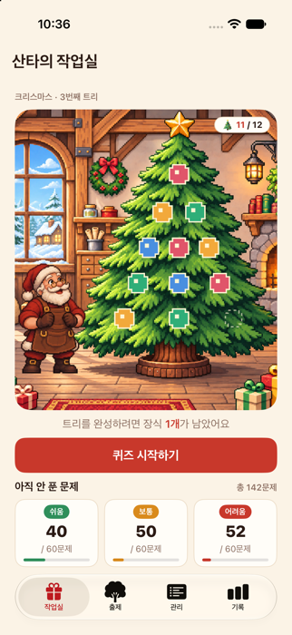</td>
      <td align="center">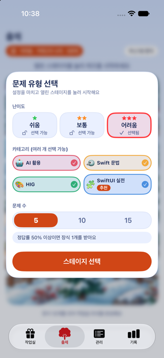</td>
      <td align="center">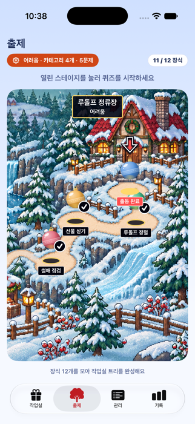</td>
      <td align="center">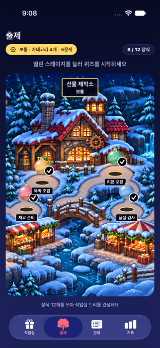</td>
    </tr>
  </tbody>
</table>

### 퀴즈 · 결과
<table align="center">
  <thead>
    <tr>
      <th align="center"><strong>문제 풀이</strong></th>
      <th align="center"><strong>힌트 (다크)</strong></th>
      <th align="center"><strong>이미지 문제</strong></th>
      <th align="center"><strong>세션 결과</strong></th>
    </tr>
  </thead>
  <tbody>
    <tr>
      <td align="center">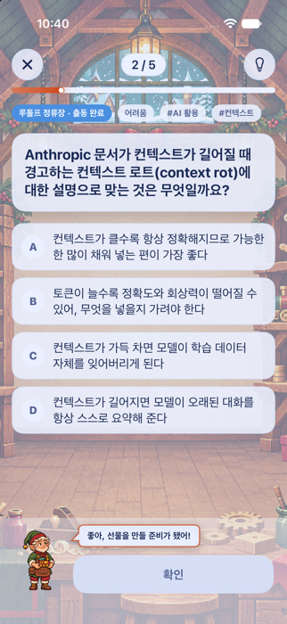</td>
      <td align="center">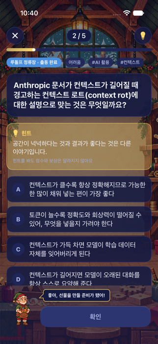</td>
      <td align="center">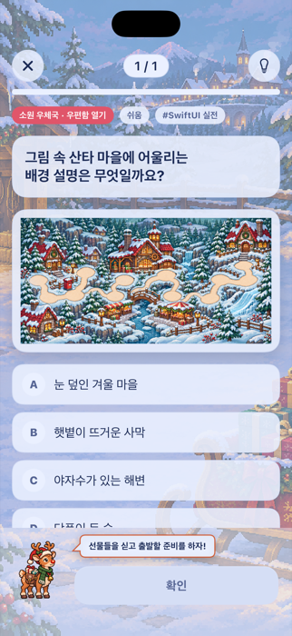</td>
      <td align="center">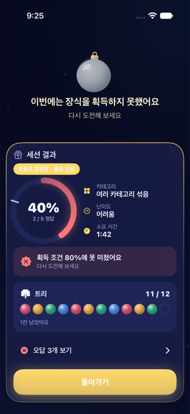</td>
    </tr>
  </tbody>
</table>

### 관리 · 기록
<table align="center">
  <thead>
    <tr>
      <th align="center"><strong>문제 관리 (라이트)</strong></th>
      <th align="center"><strong>문제 관리 (다크)</strong></th>
      <th align="center"><strong>새 문제 작성</strong></th>
      <th align="center"><strong>기록</strong></th>
    </tr>
  </thead>
  <tbody>
    <tr>
      <td align="center">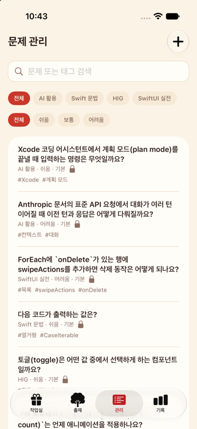</td>
      <td align="center">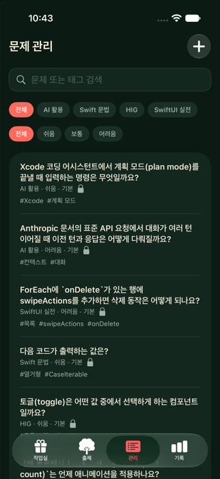</td>
      <td align="center">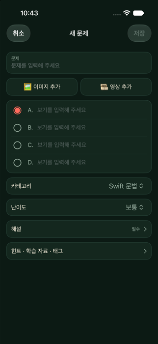</td>
      <td align="center">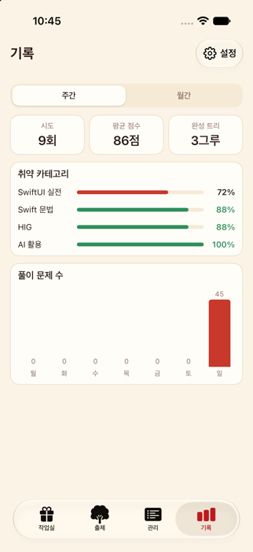</td>
    </tr>
  </tbody>
</table>

### 홈 화면 위젯
<table align="center">
  <thead>
    <tr>
      <th align="center"><strong>위젯 (다크)</strong></th>
      <th align="center"><strong>위젯 (라이트)</strong></th>
    </tr>
  </thead>
  <tbody>
    <tr>
      <td align="center">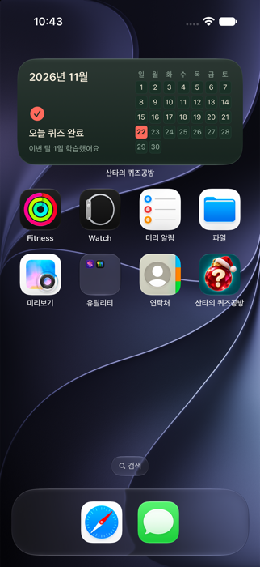</td>
      <td align="center">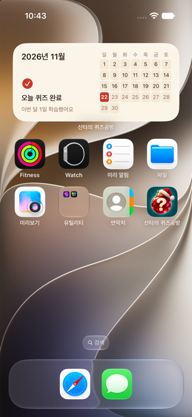</td>
    </tr>
  </tbody>
</table>

<br>

## 📁 파일 구조
~~~ bash
├── Santa'sDeliveryCrisis/
│   ├── App/                  앱 진입점, 탭 구성, 서비스 주입
│   ├── Models/               SwiftData 모델, enum
│   ├── Services/             세션, 출제, 트리, 기록 통계, 피드백, 알림
│   ├── Features/
│   │   ├── Task/             작업실
│   │   ├── Select/           출제 탭(스테이지 지도, 설정 팝업)
│   │   ├── Quiz/             퀴즈 진행, 결과, 오답 노트, 장식·트리 완성 연출
│   │   ├── Records/          기록 대시보드
│   │   ├── Manage/           문제 관리
│   │   ├── Settings/         설정
│   │   └── Shared/           공통 트리, 보상 비행 연출
│   ├── Shared/QuizActivity/  앱과 위젯이 공유하는 학습 기록
│   ├── Extensions/           공통 확장
│   └── Resources/            시드 JSON(questions.json), Metal 셰이더, Assets
├── QuizActivityWidget/       월간 퀴즈 기록 위젯
├── Tools/service-check/      서비스 로직 점검 스크립트
└── docs/                     스펙, 디자인 시안, 계약표
~~~

<br>

## ⚙ 기술 스택
- **언어**: Swift
- **UI**: SwiftUI (NavigationStack, TabView, NavigationSplitView), Metal 셰이더(장식 공개 연출)
- **저장소**: SwiftData(퀴즈, 세션, 트리 기록), UserDefaults/@AppStorage(설정)
- **차트**: Swift Charts
- **위젯**: WidgetKit
- **알림**: UserNotifications (매일 학습 알림)
- **외부 라이브러리**: 사용하지 않음
- **시드 데이터**: 4개 카테고리 × 3개 난이도 × 15문제 = 180문제
- **버전 관리 및 협업**: Git, GitHub (feature/develop/main 브랜치, Pull Request 리뷰)

<br>

## 🚀 설치 및 실행 방법

1. 리포지토리 클론
   ```bash
   git clone https://github.com/Hoon94/SantaDeliveryCrisis.git
   cd SantaDeliveryCrisis
   ```

2. Xcode에서 `Santa'sDeliveryCrisis.xcodeproj`를 엽니다.

3. 실행 대상(Scheme)을 앱으로 두고 iPhone 또는 iPad 시뮬레이터를 선택합니다.

4. 실행합니다. (⌘ + R) 첫 실행 때 시드 문제가 자동으로 들어갑니다.

> 별도의 API 키, 서버 설정, 패키지 설치는 필요하지 않습니다.

<br>

## 👥 팀원 소개
커밋 기록에서 확인한 주 작업 영역 기준입니다.

| 팀원 | 주 작업 영역 |
|------|--------------|
| [@Hoon94](https://github.com/Hoon94) (hoon) | 작업실·출제 화면, 퀴즈 연출, 디자인 문서 |
| [@Jungnovus](https://github.com/Jungnovus) (Gundong) | 퀴즈 진행·결과, 피드백(효과음·햅틱) |
| [@yang6486](https://github.com/yang6486) (yang) | 문제 관리, 기록·설정 |
| [@zarin3580](https://github.com/zarin3580) (Zarin) | 세션 로직, 시드 로더, 서비스 점검 도구 |
