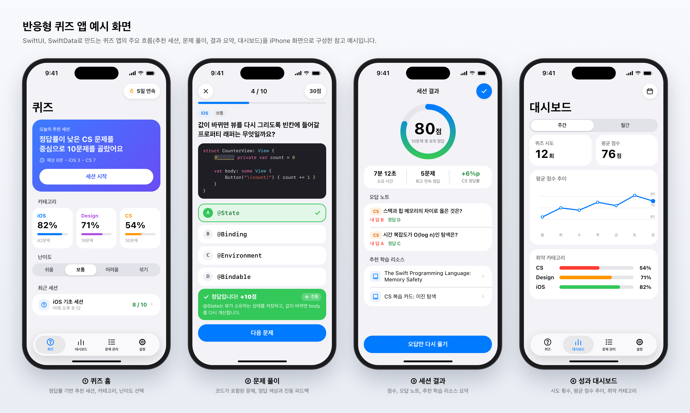
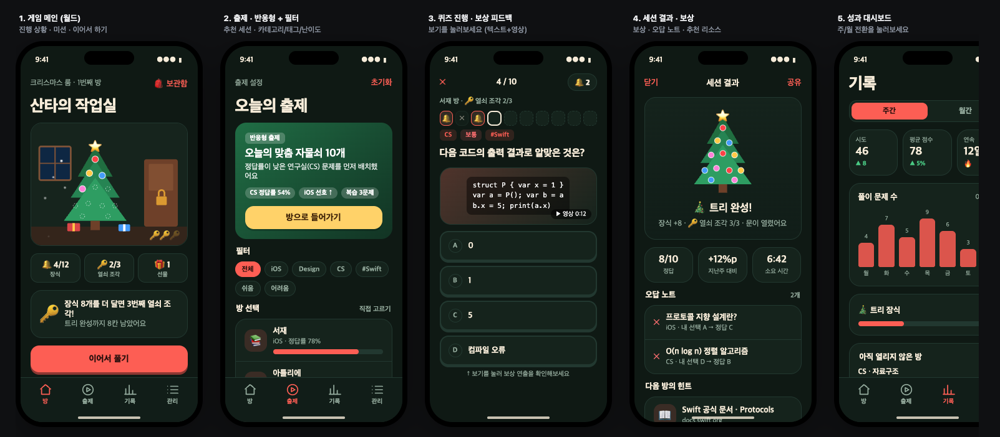

# SwiftUI, SwiftData: 반응형 컨텐츠를 활용한 퀴즈 앱 개발

> 예시 화면은 요구사항을 이해하기 위한 참고용입니다. 화면 구성과 디자인은 팀에서 자유롭게 정합니다.
> 

### 1. 핵심 기능

- **퀴즈 컨텐츠 관리(작성‧열람‧편집‧삭제)**: 문제·보기를 CRUD 할 수 있어야 합니다. 퀴즈 항목은 텍스트·이미지·영상을 포함할 수 있습니다.
- **반응형 출제 로직**: 사용자의 정답률·카테고리 선호도 등을 분석해 문제를 자동으로 선택하고 목록을 생성할 수 있어야 합니다.
- **세션 기반 진행**: 한 세션이 끝나면 점수·오답 노트·추천 학습 리소스를 요약해서 제공해야 합니다.
- **카테고리·태그 필터**: 주제(예: iOS, Design, CS)·난이도 등으로 퀴즈를 분류하고 선택적으로 출제할 수 있습니다.
- **주·월별 성과 대시보드**: 기간별 퀴즈 시도 횟수, 평균 점수, 취약 카테고리 등을 시각화합니다. 통계로 표시할 데이터 선택은 자유입니다.

### 2. 데이터 저장

- **@AppStorage 활용**: 테마, 글꼴 크기, 첫 실행 플래그 등 간단한 설정 데이터는 UserDefaults 또는 @AppStorage로 관리합니다.
- **SwiftData 활용**: 퀴즈 문제·세션 기록·정답률 통계 등의 데이터는 SwiftData로 저장합니다.

### 3. UI/UX 디자인

- **SwiftUI 네이티브 컴포넌트 우선 사용**: NavigationStack, List, Form 등을 적절히 활용해야 합니다.
- **애니메이션 & 피드백**: 정답·오답 시 컬러·진동·사운드 등을 활용해 즉각적인 피드백을 제공해야 합니다.
- **다크모드 대응**: 시스템 모드에 맞춰 색상·이미지가 자동 전환되고 자연스럽게 표시되어야 합니다.
- **지원 디바이스**: 아이폰(세로만 지원)을 기본 지원합니다. 아이패드(가로, 세로 모두)는 선택사항이며, macOS는 지원하지 않습니다.

### 4. 접근성

- **동적 글꼴 사이즈**: 사용자 설정에 따라서 폰트 크기가 업데이트 되어야 합니다. 큰 폰트로 표시되는 경우에는 UI가 최대한 망가지지 않도록 해야 합니다.
- **다국어 지원**: 다국어는 지원하지 않습니다. 영어 또는 한글 중 하나의 언어로 통일합니다.

### 5. 성능·최적화

- **크래시 방지**: 옵셔널을 안전하게 처리해야 합니다.

### 6. 배포 & 문서화

- **README 문서**: 기능 소개, 설치 방법, 의존 라이브러리, 폴더 구조 등을 Markdown으로 작성해야 합니다.
- **스크린샷·GIF 첨부**: 주요 플로우(작성-조회-통계)별로 짧은 시연 영상을 녹화해 문서에 첨부해야 합니다.
- **API 문서**: 코드에서 문서화 주석 형태로 작성해야 합니다.

# 우리가 정한 우리만의 앱 디자인 시안 및 기획서(중요!!)

## 회의록

코드를 작성할때 손 코드를 할 것인가 ai를 활용할 것인가?
-> ai를 사용하되 ai가 짜준 코드에 대해서 코드리뷰를 했을때 설명 할 수 있을정도는 되야할 것 같다.

## 주제 선정

- 프로젝트 차이
    - 주 기술스택: SwiftUI, SwiftData
    - 두 프로젝트 차임점: 애니메이션 & 피드백, 퀴즈 앱에 사용할 데이터는 무엇인지
- 선정 이유
    - 회고
        - 일기장 또는 각자의 생각마다 다른 속성들에 의해 주관적인 부분이 강할 것 같다.
    - 퀴즈
        - 반응형 컨텐츠를 활용한 오락성, 사용하면서 즐거움을 줄 수 있을것 같다.
    - 최종 선정: 퀴즈 앱

## 아이디어

- 퀴즈에 사용할 데이터를 어떻게 받아올지
    - Wikipedia 등 외부 사이트를 통해 api 형태로 받아오기
    - 앱 내부 저장소에 저장하기
- 어떤 주제로 퀴즈를 만들지
    - KxCoding 퀴즈
    - HIG
    - Swift 문법
    - 주식 관련 용어
    - AI 용어
    - 대주제: iOS 관련 학습 자기개발 주제로 결정
- 앱 컨셉
    - 탈출: 퀴즈를 다 완료하기 전에는 놀러가지 말자
        - 이미지를 활용해서 컨셉을 잡으면 쉽게 이해하기 좋다
        - 방탈출, 섬탈출
    - 크리스마스 트리 꾸미기
        - 문제를 풀 때마다 크리스마트 트리 장식이 추가
    - 샘플
        
        
        

## 최종 결정 디자인 시안

[index.html](index.html)

A. 산타의 작업실 탈출 선정

### 퀴즈 형식

- 문제
    - 텍스트
    - 이미지
    - 애니메이션을 보여 주고 정답을 맞추기
- 정답
    - 4지 선다 중 택 1 또는 복수 선택은 가능하게
    - o/x 퀴즈
    - 복수 선택 가능하게 표현 (1. a, b, c/ 2. c, d)
    - 선긋기 (사랑의 짝대기처럼 연결하기)
    - 주관식 및 서술형 (추가 구현)

- 퀴즈 애니메이션 예시
    
    [rabbit-quiz-v3.html](rabbit-quiz-v3.html)
    
    밴치마트
    
    https://dialed.gg/
    

## 앱 시나리오

크리스마스를 시작하는 트리를 잃어 버린 산타할아버지!
무사히 트리를 제작해야 크리스마스가 시작되는데!
코딩을 통해서 트리를 제작
문제를 푼다 -> 트리가 만들어지는 과정!

모든 문제를 다풀고 트리가 완성되며
메리 크리스마스와 함께 커다란 트리가 반짝반짝 빛나며 환해지고
선물을 주러가기 위해 루돌프를 탄 산타할아버지가 떠남

### 대상 사용자

iOS 및 개발에 관심 있는 사람, 학습을 위해 쉽게 문제를 풀고 게임 형식으로 성과를 얻어 장기간 사용할 수 있게 만드는 것이 목표

### 기능

- 퀴즈 데이터 관리
    - SwiftData를 통해 문제 및 보기를 CRUD 할 수 있다.
    - 퀴즈 항목은 텍스트, 이미지, 영상을 포함할 수 있다.
    - 문제, 정답 / 다음을 위한 학습 자료 및 힌트 학습 자료
    - 점수·오답 노트·추천 학습 리소스
- 데이터 저장 방식
    - SwiftData
        - 퀴즈 문제·세션 기록·정답률 통계 등의 데이터는 SwiftData로 저장
    - AppStorage(UserDefaults)
        - 테마, 글꼴 크기, 첫 실행 플래그 등 간단한 설정 데이터
- 문제 풀이 및 출제 로직
    - 풀 문제 개수 선택
    - 약점 우선 출제
    - 카테고리 선호도
- 문제 세션
    - 한 세션이 끝나면 점수·오답 노트·추천 학습 리소스를 요약해서 제공
    - 난이도 별 세션(쉬움, 보통, 어려움) 선택
    - 난이도 별 세션 해결에 대한 보상을 다르게 (예: 장식 개수-초급 1개, 중급 2개, 고급 3개)
- 세션 입장 방법
    - 트리의 장식 위치를 클릭하여 세션 시작 (추가 구현)
    - 오늘의 출제에서 난이도 선택 후 입장
- 문제 카테고리, 태그 필터
    - 주제(예: iOS - KxCodeing, HIG, Swift 문법, AI 용어 및 활용)·난이도 등으로 퀴즈를 분류하고 선택적으로 출제할 수 있습니다.
- 세션 이어가기
    - 문제 푸는 도중 앱을 종료하면 다시 켰을 때 “이어서 풀기” 진행
- 대시보드
    - 기간별 퀴즈 시도 횟수, 평균 점수, 취약 카테고리 등을 시각화
    - 통계로 표시할 데이터 선택은 자유
- 디자인
    - **SwiftUI 네이티브 컴포넌트 우선 사용**: NavigationStack, List, Form 등을 적절히 활용해야 합니다.
    - **애니메이션 & 피드백**: 정답·오답 시 컬러·진동·사운드 등을 활용해 즉각적인 피드백을 제공해야 합니다.
    - **다크모드 대응**: 시스템 모드에 맞춰 색상·이미지가 자동 전환되고 자연스럽게 표시되어야 합니다.
    - **지원 디바이스**: 아이폰(세로만 지원)을 기본 지원합니다. 아이패드(가로, 세로 모두)는 선택사항이며, macOS는 지원하지 않습니다.
- 접근성
    - **동적 글꼴 사이즈**: 사용자 설정에 따라서 폰트 크기가 업데이트 되어야 합니다. 큰 폰트로 표시되는 경우에는 UI가 최대한 망가지지 않도록 해야 합니다.
    
    https://developer.apple.com/design/human-interface-guidelines/typography
    
    - **다국어 지원**: 다국어는 지원하지 않습니다. 영어 또는 한글 중 하나의 언어로 통일합니다.

### 단어 통일

난이도는 쉬움, 보통, 어려움으로 통일

작업 선택

소원 접수, 선물 생산, 포장, 썰매 적재

### 와이어 프레임

[wireframe.html](wireframe.html)

### Git 브랜치 전략

| 브랜치 | 설명 |
| --- | --- |
| main | 운영 환경(프로덕션)에 배포되는 최종 코드 |
| develop | 통합 개발 브랜치. 기능 브랜치들이 여기에 병합 |
| feature | 기능 단위 작업 브랜치 (develop에서 분기 → develop로 병합) |

https://okbear3.tistory.com/73
